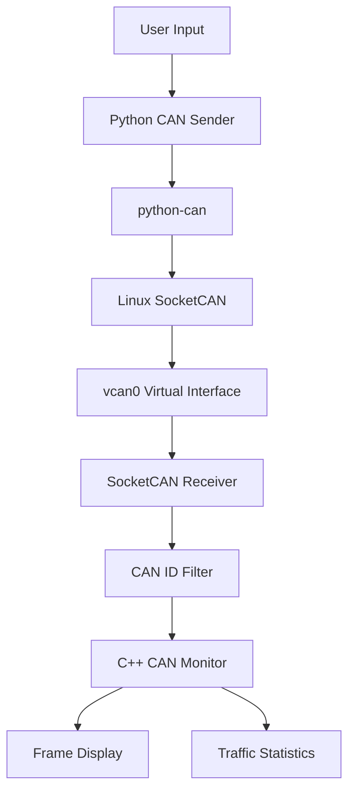

# Linux CAN Diagnostics

A Linux-based CAN traffic monitoring and diagnostics tool developed using **C++, Linux SocketCAN, and Python**.

The project receives CAN frames through a Linux CAN interface, displays their identifiers and payloads, supports user-defined CAN ID filtering, and provides basic traffic statistics.

The application is currently tested using Linux Virtual CAN (`vcan0`), allowing CAN communication to be developed and tested without physical CAN hardware.

---

## Overview

Controller Area Network (CAN) is a communication protocol commonly used in automotive systems, embedded devices, industrial automation, and distributed control systems.

Multiple devices connected to a CAN network exchange messages using CAN frames. Each frame contains an identifier, control information, and data.

This project implements a Linux-based CAN observer that receives and analyzes CAN traffic through SocketCAN.

The application allows users to:

- Monitor incoming CAN frames in real time.
- Select whether to monitor all CAN IDs or a specific CAN ID.
- View CAN identifiers, data length, and payload.
- Calculate basic traffic statistics.
- Generate test CAN frames through an interactive Python sender.
- Test communication using a virtual CAN interface.

The receiver is implemented in C++, while Python is used to generate CAN frames for testing.

---

## Features

### CAN Frame Monitoring

The application continuously receives CAN frames from the selected CAN interface.

For each received frame, it displays:

- CAN identifier
- Data Length Code (DLC)
- Data payload

Example:

```text
CAN ID: 0x123
DLC: 4
Data: 11 22 33 44
```

The monitor uses Linux SocketCAN to receive frames directly from the CAN socket.

### User-Defined CAN ID Filtering

The application provides two monitoring modes.

**Monitor all CAN IDs**

Receives all CAN frames available through the selected interface.

**Monitor specific CAN ID**

Receives only frames matching the CAN ID selected by the user.

Example:

```text
CAN Observer

1. Monitor all CAN IDs
2. Monitor specific CAN ID

Select option: 2
Enter CAN ID (hex): 123
```

The receiver applies the filter through the Linux SocketCAN raw socket API.

Frames with other identifiers are filtered before they reach the monitoring application.

### Traffic Statistics

The observer calculates basic statistics from the received frames.

| Statistic | Description |
|---|---|
| Total Frames | Total number of CAN frames received |
| Total Bytes | Total number of CAN payload bytes received |
| Unique IDs | Number of different CAN identifiers observed |
| Frames per Second | Average frame reception rate since monitoring started |
| Frames per CAN ID | Number of received frames associated with each identifier |

The statistics are calculated from the frames accepted by the configured socket filter.

When a specific CAN ID is selected, the statistics represent only the traffic received for that identifier.

### Interactive CAN Frame Sender

The project includes a Python-based CAN sender using the `python-can` library.

The sender accepts a CAN identifier and data bytes through terminal input.

Example:

```text
CAN> 123 11 22 33 44
```

This creates a CAN frame with:

```text
CAN ID: 0x123
DLC: 4
Data: 11 22 33 44
```

The sender transmits the frame through the `vcan0` interface.

Multiple frames can be transmitted without restarting the sender.

### Virtual CAN Testing

The project currently uses Linux Virtual CAN (`vcan0`).

Virtual CAN provides a software-based CAN interface that allows applications to exchange CAN frames without physical CAN hardware.

This makes it possible to develop and test the monitoring application using two terminal sessions:

- One terminal runs the CAN observer.
- Another terminal runs the Python sender.

The virtual interface is used for software testing and does not reproduce electrical CAN bus behavior.

---

## Technologies Used

| Technology | Purpose |
|---|---|
| C++ | CAN monitoring application |
| Linux SocketCAN | CAN socket creation, binding, filtering, and reception |
| Linux Virtual CAN | Hardware-independent CAN testing |
| Python | Interactive CAN frame generation |
| python-can | Python CAN communication interface |
| GNU Make | Build automation |
| Git | Version control |

---

## Project Structure

```text
can-diagnostics/
│
├── src/
│   │
│   ├── main.cpp
│   │
│   ├── socketcan/
│   │   ├── can_socket.cpp
│   │   └── can_socket.hpp
│   │
│   └── monitor/
│       ├── can_monitor.cpp
│       └── can_monitor.hpp
│
├── send_can.py
│
├── Makefile
│
└── README.md
```

### File Description

#### `src/main.cpp`

The main entry point of the application.

It:

- Defines the CAN interface.
- Accepts the monitoring mode.
- Reads the user-selected CAN ID when filtering is enabled.
- Opens the CAN socket.
- Starts the monitoring function.

#### `src/socketcan/can_socket.hpp`

Contains the declaration of the CAN socket initialization function.

It provides the interface used by the main application to open a CAN socket.

#### `src/socketcan/can_socket.cpp`

Implements CAN socket initialization.

The implementation:

1. Creates a raw CAN socket.
2. Identifies the selected network interface.
3. Retrieves the interface index.
4. Binds the socket to the interface.
5. Configures the CAN ID filter when filtering is enabled.
6. Returns the initialized socket.

The socket is created using the Linux SocketCAN API.

#### `src/monitor/can_monitor.hpp`

Contains the declaration of the CAN monitoring function.

#### `src/monitor/can_monitor.cpp`

Implements the CAN frame monitoring logic.

The monitor:

- Reads incoming CAN frames.
- Displays frame identifiers.
- Displays the data length.
- Prints received data bytes.
- Counts received frames.
- Counts received payload bytes.
- Tracks unique CAN IDs.
- Calculates average frame reception rate.
- Maintains frame counts for individual CAN IDs.

#### `send_can.py`

Implements the interactive Python CAN sender.

The script:

- Initializes a CAN interface using `python-can`.
- Accepts user input.
- Parses the CAN identifier.
- Parses the payload bytes.
- Creates a CAN message.
- Transmits the message through the virtual CAN interface.

#### `Makefile`

Automates compilation of the C++ application.

It defines:

- Compiler configuration.
- Compiler flags.
- Source files.
- Executable generation.
- Cleanup.

---

## System Architecture

The application is divided into separate components for socket initialization, frame monitoring, and frame generation.



### Architecture Description

**1. User Input**

The user enters a CAN identifier and payload through the interactive sender.

The monitoring application also accepts the user's choice of filtering mode.

**2. Python CAN Sender**

The sender converts the entered values into a CAN message.

The message contains the selected CAN identifier and payload.

**3. SocketCAN**

SocketCAN provides the Linux interface for CAN communication.

The Python sender transmits the message through the CAN interface.

**4. Virtual CAN Interface**

The `vcan0` interface provides a software-based CAN network.

It allows the sender and receiver to exchange CAN frames without physical hardware.

**5. SocketCAN Receiver**

The C++ application opens a raw CAN socket and binds it to the selected interface.

Incoming frames are delivered to the application through the socket.

**6. CAN ID Filter**

The configured filter determines which CAN identifiers are accepted by the receiver.

When monitoring all IDs, the application receives all frames available through the interface.

When monitoring a specific ID, frames with other identifiers are filtered out.

**7. CAN Monitor**

The monitoring component reads accepted frames and extracts their identifier, data length, and payload.

**8. Statistics**

The monitor maintains counters and calculates basic traffic statistics from received frames.

---

## CAN Frame Structure

The application currently uses standard CAN frames.

A standard CAN frame contains an 11-bit identifier and can carry up to 8 bytes of data.

| Field | Description |
|---|---|
| CAN ID | Identifier associated with the message |
| DLC | Number of data bytes |
| Data | Payload transmitted in the frame |

Example:

```text
CAN ID: 0x123
DLC: 4
Data: 11 22 33 44
```

The CAN identifier is entered in hexadecimal format.

For example:

```text
123
```

represents:

```text
0x123
```

The identifier is used for message identification and CAN bus arbitration.

It does not directly identify the physical sender.

---

## SocketCAN Implementation

SocketCAN is the Linux subsystem that provides CAN communication through the socket interface.

The project uses a raw CAN socket.

The socket initialization process consists of the following steps.

### 1. Create Socket

The application creates a raw CAN socket using:

```cpp
socket(PF_CAN, SOCK_RAW, CAN_RAW);
```

This allows the application to receive and transmit CAN frames through the Linux CAN networking subsystem.

### 2. Identify Interface

The application retrieves the interface index associated with the selected CAN interface.

For the current implementation, the interface is:

```text
vcan0
```

### 3. Bind Socket

The socket is bound to the selected CAN interface.

After binding, the application receives CAN frames from that interface.

### 4. Configure Filter

When the user selects a specific CAN ID, the application configures a SocketCAN raw filter.

The filter contains:

- CAN identifier
- CAN identifier mask

The mask determines which identifier bits are compared.

### 5. Receive Frames

The monitoring application reads CAN frames from the socket.

The received frame is then processed by the monitoring component.

---

## CAN ID Filtering

The application supports user-selected filtering.

### Monitor All IDs

When this mode is selected, the application does not install a CAN ID filter.

All frames available through the selected interface can be received.

### Monitor Specific ID

When a specific CAN ID is selected, the application configures a raw socket filter.

Example:

```text
Selected CAN ID: 0x123
```

The filter compares the standard 11-bit CAN identifier.

Frames matching the selected identifier are delivered to the monitoring application.

Frames with other identifiers are ignored by that socket.

The current implementation supports standard CAN identifiers from:

```text
0x000 to 0x7FF
```

---

## Traffic Statistics

The monitoring component maintains statistics while receiving CAN frames.

### Total Frames

Counts the number of CAN frames successfully received by the application.

Each accepted frame increments the counter.

### Total Data Bytes

Counts the payload bytes received.

For each frame, the number of payload bytes is determined by the frame's DLC.

The total byte count is updated using the received frame length.

### Unique CAN IDs

Tracks the different CAN identifiers observed during monitoring.

A map is used to maintain the number of frames associated with each identifier.

The number of entries in the map represents the number of unique IDs observed.

### Frames per CAN ID

Maintains a separate count for each CAN identifier.

Example:

```text
Frames per CAN ID:

ID 0x123 : 10 frames
ID 0x456 : 5 frames
ID 0x200 : 3 frames
```

These counts allow the user to identify which identifiers are generating the most traffic.

### Frames per Second

The application calculates the average frame reception rate.

The calculation is:

```text
Frames per second = Total received frames / Elapsed time
```

This represents the average number of received frames per second since monitoring started.

It is not the CAN bus bit rate or bus utilization.

---

## Installation and Requirements

The project requires a Linux environment with SocketCAN support.

### Required Software

- Linux operating system
- GCC or compatible C++ compiler
- GNU Make
- Python
- `python-can`

### Virtual CAN Interface

The project uses:

```text
vcan0
```

Check available network interfaces:

```bash
ip link
```

Check the virtual CAN interface:

```bash
ip link show vcan0
```

The interface must exist and be enabled before running the application.

---

## Build Instructions

Clone the repository:

```bash
git clone <repository-url>
```

Enter the project directory:

```bash
cd can-diagnostics
```

Compile the application:

```bash
make
```

The Makefile compiles the C++ source files and generates:

```text
can_diagnostics
```

To remove the generated executable:

```bash
make clean
```

To rebuild:

```bash
make clean
make
```

---

## Running the Application

### Step 1: Start the Observer

Run:

```bash
./can_diagnostics
```

The application displays the available monitoring modes.

```text
CAN Observer

1. Monitor all CAN IDs
2. Monitor specific CAN ID

Select option:
```

### Step 2: Select Monitoring Mode

For all CAN IDs:

```text
Select option: 1
```

For a specific CAN ID:

```text
Select option: 2
Enter CAN ID (hex): 123
```

The application initializes the CAN socket and starts monitoring.

### Step 3: Start the Sender

Open another terminal in the project directory.

Run:

```bash
/usr/bin/python send_can.py
```

The sender displays:

```text
CAN Terminal

Enter CAN ID and data
Example: 123 11 22 33 44
Type exit to stop

CAN>
```

### Step 4: Transmit CAN Frame

Enter:

```text
CAN> 123 11 22 33 44
```

The sender creates and transmits a CAN frame.

The observer displays the received frame.

### Step 5: Transmit Additional Frames

Example:

```text
CAN> 123 AA BB CC
CAN> 456 01 02 03
CAN> 200 11 22
```

The observer displays frames accepted by its selected filter.

---

## Testing

The project is currently tested using Linux Virtual CAN.

The testing procedure uses two terminal sessions.

### Test 1: Monitor All CAN IDs

Start the observer:

```bash
./can_diagnostics
```

Select:

```text
1. Monitor all CAN IDs
```

Start the sender:

```bash
/usr/bin/python send_can.py
```

Transmit:

```text
CAN> 123 11 22 33 44
CAN> 456 AA BB CC
CAN> 200 01 02
```

Expected behavior:

- All transmitted frames are received.
- Each frame is displayed with its identifier.
- The data length is displayed.
- The payload is displayed.
- Traffic statistics include the received frames.

### Test 2: Monitor Specific CAN ID

Start the observer and select:

```text
2. Monitor specific CAN ID
```

Enter:

```text
123
```

Transmit:

```text
CAN> 123 11 22 33 44
CAN> 456 AA BB CC
CAN> 200 01 02
```

Expected behavior:

- Frame `0x123` is received.
- Frames `0x456` and `0x200` are filtered out.
- Statistics count only frames received by the observer.

### Test 3: Multiple Frames with Same ID

Transmit:

```text
CAN> 123 11 22
CAN> 123 AA BB
CAN> 123 01 02
```

Expected behavior:

- All three frames are received.
- Total frame count increases.
- Total payload byte count increases.
- The frame count for CAN ID `0x123` increases.

### Test 4: Multiple CAN IDs

Select monitoring of all IDs.

Transmit:

```text
CAN> 123 11 22
CAN> 456 AA BB
CAN> 200 01 02
```

Expected behavior:

- All three frames are received.
- Three unique CAN IDs are observed.
- Frame counts are maintained separately for each identifier.

---

## Current Implementation Status

| Component | Status |
|---|---|
| C++ CAN receiver | Implemented |
| SocketCAN socket initialization | Implemented |
| CAN interface binding | Implemented |
| Virtual CAN testing | Working |
| Interactive Python sender | Implemented |
| User-defined CAN ID filtering | Implemented |
| CAN frame display | Implemented |
| Total frame counter | Implemented |
| Total payload byte counter | Implemented |
| Unique CAN ID tracking | Implemented |
| Frame count per CAN ID | Implemented |
| Average frames per second | Implemented |
| CSV logging | Planned |
| Live dashboard | Planned |
| Command-line configuration | Planned |
| Physical CAN hardware testing | Planned |

---

## Limitations

The current implementation has the following limitations:

- Testing is performed using Virtual CAN.
- Physical CAN hardware has not yet been tested.
- The monitoring application currently supports standard 11-bit CAN identifiers.
- The filter is configured when the application starts.
- Statistics are based on frames received by the selected socket.
- The frame reception loop uses blocking socket reads.
- The current statistics are basic traffic counters and do not calculate CAN bus utilization.
- The application does not currently decode vehicle-specific CAN signals.
- The application does not currently perform ECU diagnostics or retrieve diagnostic trouble codes.

---

## Future Implementation

### CSV Logging

Add the ability to save received CAN frames to a CSV file.

The log will include:

- Timestamp
- CAN ID
- DLC
- Payload

This will allow captured traffic to be analyzed after monitoring ends.

### Live Statistics Dashboard

Improve the statistics display by refreshing the dashboard in place.

The dashboard will display:

- Total frames
- Total data bytes
- Unique CAN IDs
- Frames per second
- Frame counts per CAN ID

### Command-Line Configuration

Add command-line options to configure:

- CAN interface
- CAN ID filter
- Monitoring mode
- Logging options

This will allow the application to start monitoring without requiring interactive configuration.

### Improved Error Handling

Improve handling of:

- Socket initialization failures
- Invalid interface names
- CAN read errors
- Invalid input
- Filter configuration failures

### Physical CAN Interface Support

Extend testing to a physical CAN interface.

This will require compatible CAN hardware and a CAN transceiver.

The application will then be able to monitor frames exchanged over a physical CAN network.

---

## Conclusion

Linux CAN Diagnostics is a C++ application that uses Linux SocketCAN to monitor CAN traffic.

The project implements CAN socket initialization, frame reception, user-defined CAN ID filtering, frame display, and basic traffic statistics.

A Python sender provides an interactive method for generating CAN frames.

Linux Virtual CAN allows the application to be tested without physical CAN hardware.

The current implementation provides a foundation for further development into a configurable CAN traffic monitoring and diagnostics tool.
